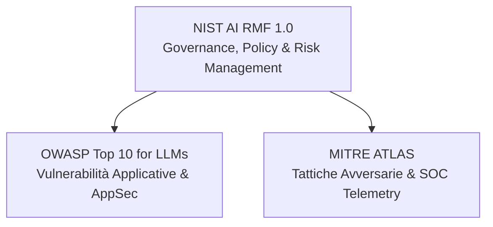

# 🧠 AI Security Fundamentals: Core Takeaways, Frameworks & Real-World Operations

- **Dominio:** AI Security, Machine Learning Security, LLM Threat Modeling
- **Framework di Riferimento:** OWASP Top 10 for LLMs, MITRE ATLAS, NIST AI RMF (Risk Management Framework)
- **Scopo:** Sintesi operativa e metodologica per Security Architects, Auditor e Threat Hunters.

---

## 1. Architettura Neurale e Meccanica Computazionale

Un sistema di Machine Learning non possiede consapevolezza logica deterministica; è una funzione matematica parametrica che calcola probabilità statistiche su rappresentazioni numeriche (vettori).

### Il Flusso Feedforward (Layer Pipeline)

| Livello (Layer) | Natura dei Dati | Funzione Computazionale |
| :--- | :--- | :--- |
| **Input Layer** | Feature grezze / Token numerici | Ingestione diretta delle misurazioni esterne prive di contesto semantico. |
| **Hidden Layer(s)** | Pattern astratti e rappresentazioni latenti | Applicazione di pesi lineari e funzioni di attivazione non lineari (ReLU, Sigmoid). |
| **Output Layer** | Distribuzione di probabilità (Softmax) | Decisione finale, classificazione categoriale (label) o selezione del token successivo. |

### Concetti Chiave
- **Model Weights (Pesi/Parametri):** La matrice numerica risultante dalla fase di ottimizzazione (*Gradient Descent* / *Backpropagation*). Costituiscono la **memoria a lungo termine** e la logica di calcolo del modello.
- **Non-Determinismo:** Proprietà dei modelli generativi dovuta al campionamento stocastico durante l'inferenza (*Temperature*, *Top-p*). Lo stesso input esatto può produrre output differenti tra iterazioni distinte.

---

## 2. Tassonomia delle Minacce ai Modelli (Model Vulnerabilities)

| Categoria | Vettore d'Attacco | Rischio Primario | Esempio Pratico Reale |
| :--- | :--- | :--- | :--- |
| **Model Inversion / Training Data Extraction** | Interrogazione ricorsiva delle API calcolando l'entropia/confidenza o forzando la divergenza di campionamento. | **Violazione Privacy / Data Breach** | *Carlini et al. (GPT-2):* estrazione *verbatim* di indirizzi email privati, numeri di telefono e chiavi SSH memorizzate nei pesi durante il pre-training. |
| **Data / Memory Poisoning** | Iniezione di campioni malevoli o trigger predefiniti nel dataset di training, fine-tuning o nella memoria RAG a lungo termine. | **Integrità & Sabotaggio Logico** | Avvelenamento di repository open source o forum: l'LLM addestrato impara che una specifica parola chiave esenta il codice generato dai controlli di sicurezza. |
| **Model Stealing / Extraction** | Interrogazione massiva a scatola nera (Black-Box querying) del modello vittima (*Teacher*) per addestrare un clone (*Student*). | **Perdita di Proprietà Intellettuale** | Clonazione di API commerciali proprietarie tramite generazione di milioni di coppie prompt/risposta per addestrare modelli open-source senza costi di R&D. |

---

## 3. Matrice Comparativa dei Framework di Sicurezza AI

Per governare la sicurezza dei sistemi intelligenti si adottano tre standard complementari, ciascuno operante su un livello distinto:

### Dettaglio dei Framework

| Framework | Target Primario | Focus Metodologico | Domanda Cardine |
| :--- | :--- | :--- | :--- |
| **NIST AI RMF 1.0** | C-Level, Compliance, Governance | Gestione del rischio organizzativo, bias, affidabilità e trasparenza (Govern, Map, Measure, Manage). | *«Come governa l'azienda l'impatto e il rischio sistemico dell'AI?»* |
| **OWASP Top 10 for LLMs** | Sviluppatori, AppSec, Auditor | Debolezze architetturali, difetti del codice, configurazione errata di API e modelli. | *«Quali falle software ho introdotto integrando questo LLM?»* |
| **MITRE ATLAS** | SOC, Red Team, Threat Hunters | Matrice a griglia della Kill Chain: tecniche e procedure impiegate da aggressori contro sistemi ML. | *«Quali passaggi tecnici sta eseguendo l'attaccante per colpire il modello?»* |

### Voci Cardine OWASP LLM Top 10
- **LLM01: Prompt Injection (Direct & Indirect):** Manipolazione del contesto di sistema tramite input malevoli diretti o tramite ingestione di documenti esterni avvelenati.
- **LLM02: Sensitive Information Disclosure:** Fuga non intenzionale di chiavi crittografiche, credenziali o dati personali tramite risposte verbali.
- **LLM03: Supply Chain Vulnerabilities:** Compromissione di modelli pre-addestrati, estensioni o dataset provenienti da fonti terze non verificate.
- **LLM06: Excessive Agency:** Concessione di autonomia o autorizzazioni sproporzionate a un agente (es. accesso a shell o database di scrittura) senza validazione Human-in-the-Loop.

---

## 4. Prompt Engineering Difensivo vs Prompt Security

### Tecniche di Controllo Operativo
- **Zero-Shot:** Direttiva pura senza esempi, dipendente dalla sola capacità di generalizzazione del modello.
- **Few-Shot:** Uso di coppie `[Input] -> [Output]` contestualizzate prima del task reale per ridurre la varianza di formattazione.
- **Chain-of-Thought (CoT):** Richiesta esplicita di ragionamento analitico sequenziale ("Think step-by-step") prima dell'output conclusivo, utile a ridurre allucinazioni logiche su log complessi.

### Il Problema Strutturale dei Modelli Transformer
Nei Transformer non esiste separazione fisica tra il canale di controllo (le istruzioni del programma / System Prompt) e il canale dei dati (l'input immesso dall'utente). Tutto viene concatenato all'interno dello stesso tensore di token.

- **Conseguenza tecnica:** Nessuna regola formulata in linguaggio naturale all'interno del prompt è sicura al 100% contro la Prompt Injection.
- **Rimedio architetturale:** La sicurezza non deve basarsi sul prompt, ma su controlli esterni deterministici (validazione degli input, WAF per LLM, privilegi minimi sulle API a valle).

---

## 5. Machine Learning Tradizionale applicato alla Digital Forensics (DFIR)

Gli LLM generativi non sostituiscono il Machine Learning statistico nel SOC: operano a livelli complementari.

- **UEBA (User & Entity Behavior Analytics):** Algoritmi di clustering (K-Means) o rilevamento delle anomalie (Isolation Forest) calcolano deviazioni standard dal comportamento basale degli utenti (es. login simultanei da geolocalizzazioni incompatibili).
- **Calcolo dell'Entropia:** Misurazione della densità di casualità dei dati nei file. Un'entropia prossima a 8.0 in cartelle applicative utente (`/tmp`, `AppData\Local`) denota file compilati, offuscati o cifrati da ransomware.

---

## 6. Checklist di Pre-Deployment Audit (Threat Modeling per Sistemi AI)

Prima dell'approvazione di qualsiasi applicazione o agente AI per l'ambiente di produzione, la revisione di sicurezza impone la verifica di quattro vincoli fondamentali:

1. **Confini di Autorizzazione (Access Control & Scoping):**
   - L'agente ha accesso solo a dati strettamente necessari (Principio del Minimo Privilegio)?
   - Le API collegate utilizzano chiavi dedicate con permessi granulari di sola lettura ove possibile?

2. **Integrità e Sanitizzazione (Indirect Injection):**
   - Se l'LLM legge email, PDF o siti web esterni, i contenuti vengono sanitizzati prima di essere incorporati nel contesto per prevenire l'esecuzione di comandi nascosti?

3. **Gestione della Memoria (Data Retention):**
   - I prompt e le risposte vengono memorizzati in chiaro o riutilizzati per il riaddestramento del modello?
   - È presente un filtro automatico di DLP (Data Loss Prevention) che blocca l'invio di PII, segreti di codice o credenziali prima che raggiungano l'API del provider?

4. **Supervisione Umana (Human-in-the-Loop):**
   - Qualsiasi azione irreversibile (cancellazione record, trasferimenti finanziari, modifiche di configurazione di rete) richiede l'autorizzazione esplicita di un operatore umano?